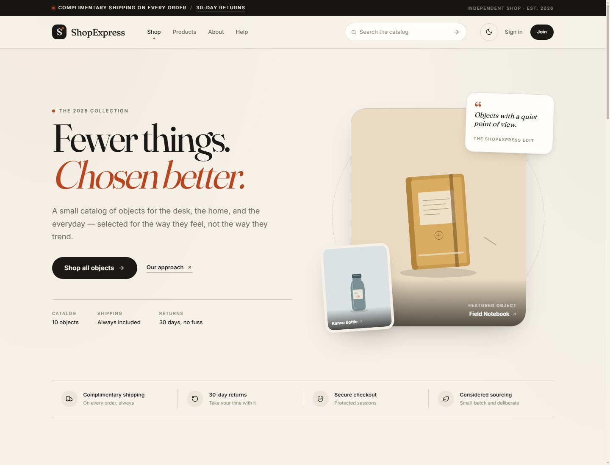
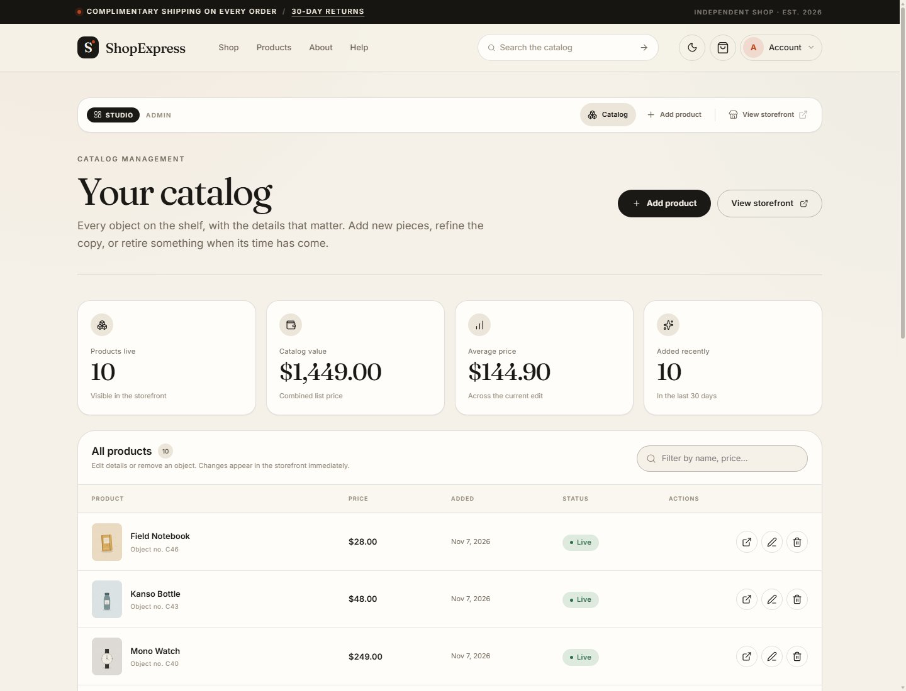
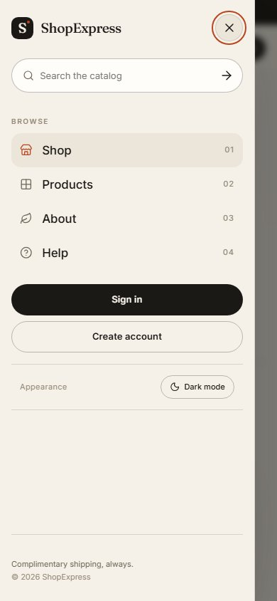

# ShopExpress

A considered, editorial e-commerce storefront built with Express, EJS, and MongoDB. ShopExpress pairs a warm, type-led visual system with a complete shopping flow: searchable catalog, product detail pages, cart, accounts, order history, and an admin studio for managing the collection.



## What is included

- **Editorial storefront** — a designed home page with a featured edit, brand story, and value sections.
- **Searchable catalog** — server-side search, price filters, sorting, and an intentional empty state.
- **Product detail pages** — quantity selection, related objects, delivery information, and sign-in prompts for guests.
- **Cart** — persistent per-account cart, quantity steppers, remove actions, and a summary with an order confirmation step.
- **Accounts** — signup, login, logout, password reset requests, and new-password pages. Sessions are regenerated on login.
- **Order history** — order cards, lifetime stats, and a clear status label.
- **Admin studio** — an at-a-glance dashboard (revenue, orders, customers, six-month chart, top objects, recent orders), catalog statistics, a responsive product table, search/filter, create and edit forms with live preview, and safe delete confirmation.
- **Light and dark appearance** — system-aware initial theme, persisted preference, and a toggle in the header and mobile menu.
- **Responsive design** — dedicated layouts for desktop, laptop, tablet, and mobile; verified at 390, 768, 1024, and 1440 px.
- **Accessibility** — skip link, labelled controls, visible focus states, keyboard-friendly navigation, focus containment in the mobile drawer, reduced-motion support, and an accessible native confirmation dialog.
- **Security-minded defaults** — CSRF protection, hashed passwords, generic login/reset responses, CSP and security headers, escaped search input, and ownership checks on admin product actions.
- **Self-hosted assets** — Inter and Fraunces webfonts and a Lucide icon sprite; no runtime CDN dependency.
- **Seed data** — a ten-object catalog, an admin account, a demo customer, and a sample order for immediate exploration.

### Admin studio



### Mobile menu



## Stack

| Layer | Choice |
| --- | --- |
| Server | Node.js, Express 4 |
| Views | EJS 3, server-rendered |
| Data | MongoDB via Mongoose |
| Sessions | `express-session` + `connect-mongodb-session` |
| Auth | `bcryptjs`, CSRF tokens with `csurf` |
| Styling | Hand-written CSS design system; custom properties for theming |
| Client | Vanilla JavaScript, no runtime framework |
| Icons | Self-hosted Lucide sprite |
| Fonts | Self-hosted Inter and Fraunces |

## Getting started

### Prerequisites

- Node.js **20.19+** (the scripts use `--env-file-if-exists`)
- A running MongoDB instance (local or Atlas)

### Install and run

```bash
npm install
cp .env.example .env
# Edit .env: set MONGODB_URI, SESSION_SECRET, ADMIN_EMAIL, ADMIN_PASSWORD.
npm run seed
npm run dev
```

Open <http://localhost:3000>.

The seed is idempotent for products and accounts. It reads `ADMIN_EMAIL` / `ADMIN_PASSWORD` (and optionally `DEMO_EMAIL` / `DEMO_PASSWORD`) from `.env`. **No credentials are stored in this repository** — if you don't set a development password, the seed generates a random one and prints it once in the terminal output when it creates the account. `.env` is git-ignored; never commit it.

### Scripts

| Command | Purpose |
| --- | --- |
| `npm start` | Run the app, loading `.env` if present |
| `npm run dev` | Same, with Node watch mode |
| `npm run seed` | Create/refresh seed accounts, catalog, and sample order |
| `npm test` | Run the unit tests for catalog query and formatting helpers |
| `npm run check` | Syntax-check every JS file and compile every EJS view in-process |

## Environment

See [`.env.example`](.env.example). The important values:

- `MONGODB_URI` — required in production. Always include the database name in the path (for example `.../shopexpress`); without it the driver falls back to the `test` database.
- `SESSION_SECRET` — required in production; use a long random string.
- `ADMIN_EMAIL` / `ADMIN_PASSWORD` — development bootstrap and seed credentials.
- `DEMO_EMAIL` / `DEMO_PASSWORD` — optional seeded customer.
- `EMAIL_HOST` / `EMAIL_PORT` / `EMAIL_SECURE` / `EMAIL_USER` / `EMAIL_PASS` — optional nodemailer SMTP settings. For Gmail use `smtp.gmail.com` / `465` / `true` with the store's Gmail address and a Google App Password (Google Account → Security → 2-Step Verification → App passwords — **not** the account password; Gmail rejects regular passwords with `BadCredentials`). When unset, emails are skipped with a warning and the app still works.
- `MAIL_FROM` — the sender address; defaults to `EMAIL_USER`.
- `SENDGRID_API_KEY` — legacy fallback, used only when no SMTP credentials are set.
- `APP_URL` — public URL used in email links.
- `NODE_ENV` — set to `production` when deploying over HTTPS.

## Design system

The new identity is a warm, editorial counterpoint to the usual blue SaaS dashboard:

- **Palette** — bone paper, ink, and a single terracotta accent, with muted sage, clay, and sand imagery.
- **Type** — Fraunces for display headlines and section titles; Inter for UI, labels, and body copy.
- **Shape** — mostly quiet 12–28 px surfaces with pill-shaped controls, fine border rules, and generous spacing.
- **Motion** — short, restrained transitions and a scroll reveal that respects `prefers-reduced-motion`.
- **Theme** — semantic CSS custom properties flip for dark mode; the initial theme respects the OS and can be persisted by the user.

Key files:

- [`public/css/main.css`](public/css/main.css) — tokens, typography, layout, buttons, forms, header/footer, shared components.
- [`public/css/shop.css`](public/css/shop.css) — home, catalog, product detail, cart, orders, about, help, error pages.
- [`public/css/auth.css`](public/css/auth.css) — account pages.
- [`public/css/admin.css`](public/css/admin.css) — admin studio.
- [`public/js/theme.js`](public/js/theme.js) — no-flash theme bootstrap.
- [`public/js/main.js`](public/js/main.js) — navigation, theme, validation, password tools, previews, filters, dialogs, reveals.

## Project structure

```text
app.js                     Express app, security headers, routes, bootstrap
controllers/               Shop, auth, admin, and error handlers
middleware/                is-auth, is-admin
models/                    User, Product, Order
routes/                    shop, auth, admin
util/                      catalog query helpers, formatting, icons, mailer
views/                     EJS views and shared includes
public/css/                main, shop, auth, admin styles
public/js/                 theme bootstrap and interactions
public/fonts/              self-hosted Inter and Fraunces + OFL licenses
public/icons/              Lucide sprite + ISC license
public/images/products/    ten product illustrations
scripts/seed.js            development seed
scripts/check-syntax.js    JS + EJS syntax check
tests/                     node:test unit tests
docs/                      README screenshots
```

## Testing and QA

The project was verified with both unit tests and an automated browser pass using a headless Edge build:

- `npm test` — 15 unit tests covering catalog query parsing/escaping/sorting and formatting helpers.
- `npm run check` — 24 JavaScript files and 24 EJS templates compiled/parsed successfully.
- **39/39 automated browser checks passed** against the running app. These covered guest catalog search/filter/sort, signup validation, duplicate registration, case-insensitive login, password reset, cart quantity changes, quantity caps, order placement, order history, admin login, product create/edit/delete with live preview, delete confirmation, 403 for non-admin, 404, light/dark toggling, mobile drawer open/escape/close, responsive overflow, and DOM accessibility basics at 390, 768, 1024, and 1440 px.
- Accessibility spot checks: images have alt text, icon-only controls have accessible names, form fields have labels, and pages contain no duplicate IDs.

There is no ESLint configuration in this repository; `npm run check` is the built-in syntax gate.

## Deployment notes

1. Provision MongoDB and set `MONGODB_URI`. The default local fallback is deliberately disabled for production startup.
2. Set a strong `SESSION_SECRET` and `NODE_ENV=production`.
3. Run behind HTTPS. Production cookies are marked `secure`, so login will not persist over plain HTTP.
4. Set `APP_URL` to the public origin for email links.
5. Set `EMAIL_USER` and `EMAIL_PASS` (Gmail App Password) if you want welcome/reset/order-confirmation email delivery; the app otherwise works without it.
6. Start with `npm start`. Sessions and carts are stored in MongoDB, so the app is stateless apart from the database.

## Known limitations

- This is a demonstration storefront: **no payment is collected and no shipping address is captured**. Orders are recorded in the account's history, which is clearly noted on the cart and help pages.
- Product images are uploaded by the admin from the browser (JPEG, PNG, WebP, AVIF, GIF · up to 5 MB each · up to 8 per product) and stored under `public/images/uploads/` (git-ignored). Products carry a `sizes` list for apparel-style items (e.g. the Linen Throw); buyers must pick one before adding to the cart, and it is kept in the cart, the order snapshot, and the confirmation email.
- The seeded catalog photographs are sourced from Unsplash (free license) and committed under `public/images/products/`.
- Email delivery is optional and depends on SMTP credentials (Gmail App Password, or the legacy SendGrid fallback).
- The backend intentionally keeps its legacy Mongoose 5 driver to avoid rewriting the existing data layer; `npm install` reports audit advisories from that dependency tree. Treat a production deployment as an opportunity to plan a Mongoose/driver upgrade.
- There is no rate limiting, background job queue, or multi-admin role system.
- Very large catalogs would need pagination; the seeded catalog is intentionally small.

## Credits

- Product illustrations were created for this project as vector artwork.
- [Inter](https://github.com/rsms/inter) and [Fraunces](https://github.com/undercasetype/Fraunces) are licensed under the SIL Open Font License; license files are included in `public/fonts/`.
- [Lucide](https://lucide.dev) icons are licensed under the ISC License; the license is included in `public/icons/`.
- The project is released under the ISC License; see [`LICENSE`](LICENSE).
